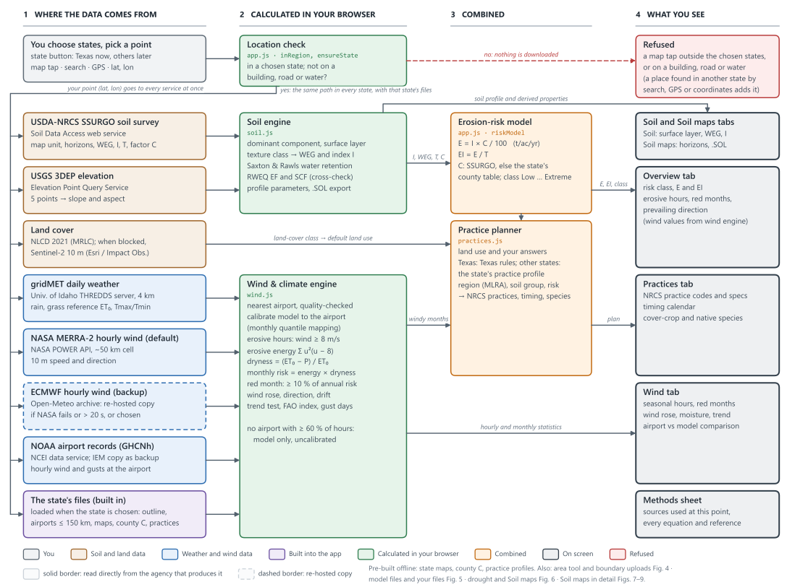
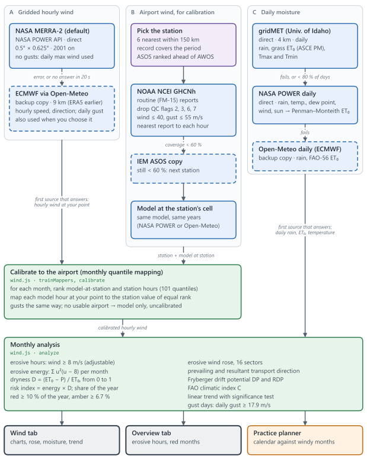
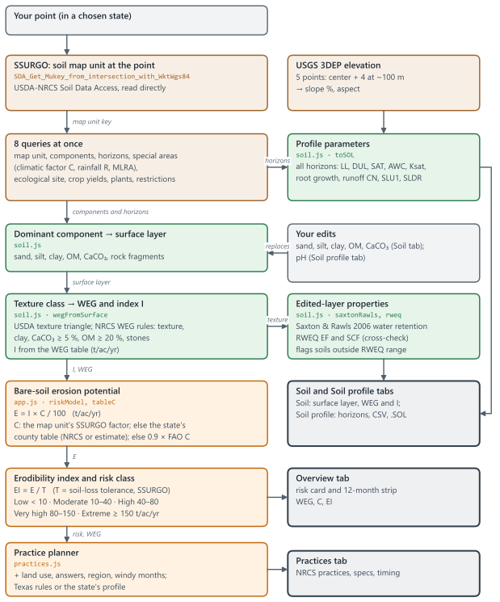
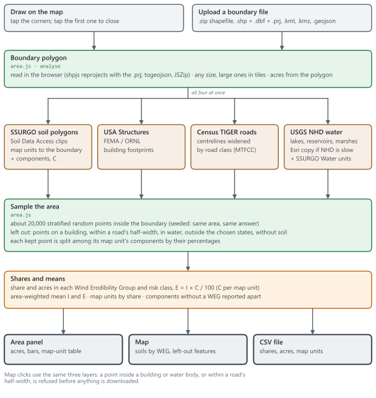
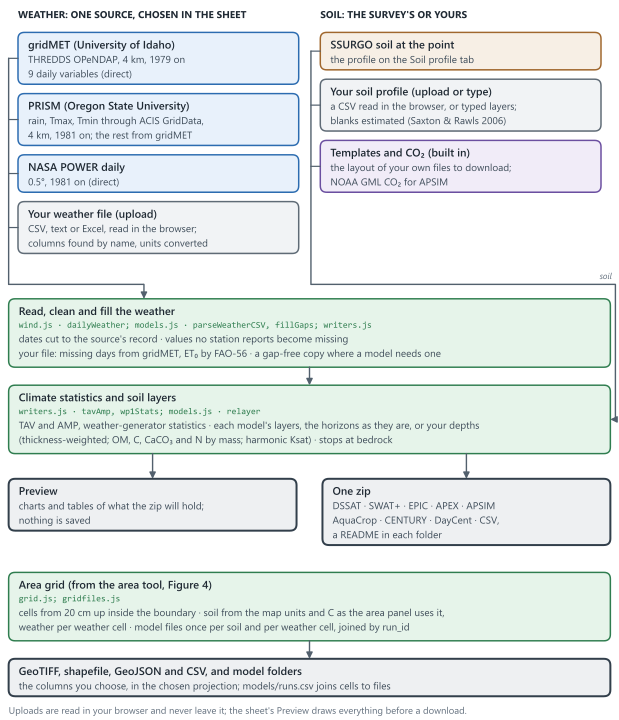
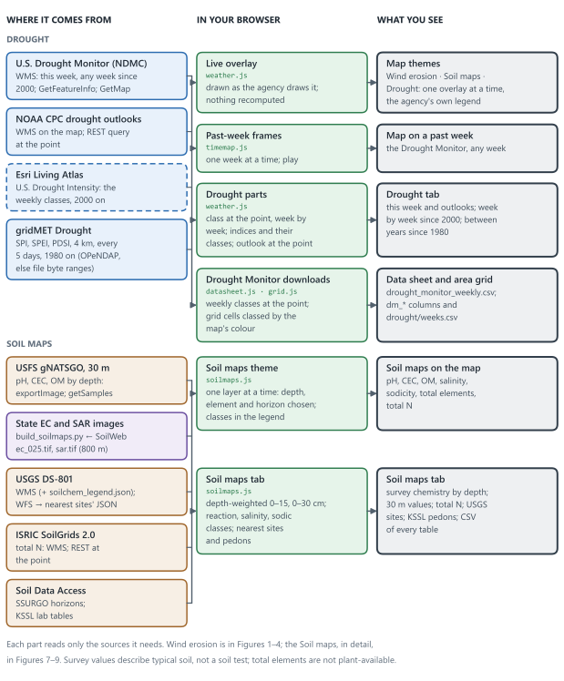
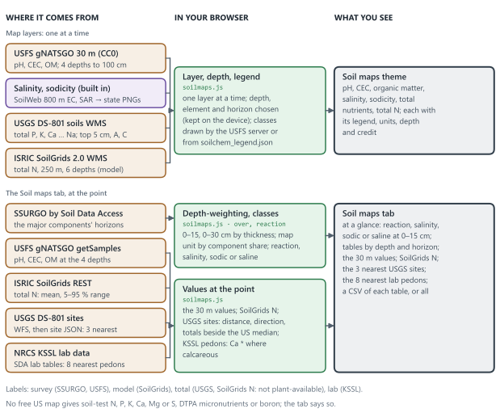
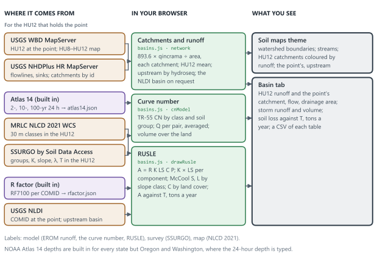
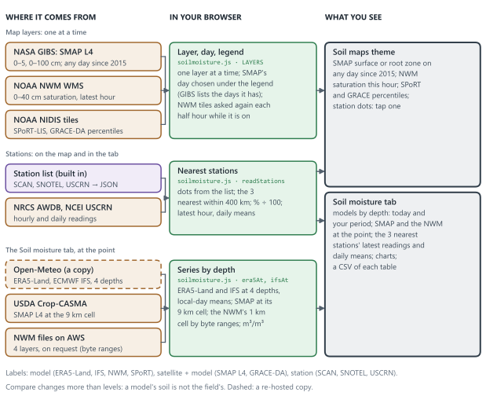

# SoilGuard

SoilGuard is a free, mobile-friendly web app for a field or any point you pick: wind-erosion risk and a control plan, the soil profile, soil-chemistry maps (pH, salinity, sodicity, CEC, organic matter, total nutrients), runoff and soil loss in the small watershed around the point, soil moisture by depth, drought now and since 2000, and model-ready soil and weather files. It covers **Texas** now; the other states come later. Every source is free and open, read directly from the agency that makes it (except the soil moisture models, from Open-Meteo's copy), and credited below. Live site: <https://barsa1ly.github.io/soilguard/>.

Tap the map, search a place, use GPS, or type coordinates. Points outside Texas are refused for now, and so are map clicks on a building, a road or water; the state button lists the other states as “(later)”. Search suggests towns, cities and counties as you type ("Tem" lists Temple, TX and the other Temples); press Enter to search a street address. The area tool analyses a whole field or ranch instead of one point. The app then pulls the soil survey, 10 years of hourly wind and the land cover for that point. It shows the risk, the wind-prone months, the full soil profile, the soil's chemistry by depth, runoff and soil loss in its small watershed, soil moisture by depth, drought at the point, and practices matched to the land use you choose.

## Run it

It is a static site with no build step and no API keys. Serve the folder with any web server:

```bash
python -m http.server 8765
```

Then open <http://localhost:8765>. Opening `index.html` straight from disk also works in most browsers, but a server is more reliable. To link straight to a location, use `?lat=32.74&lon=-101.95`; add `&map=drought` or `&map=soilmaps` to open on that theme. Add `&from=2024-01-01&to=2024-12-31` (or `&period=5` or `&period=20`) for the wind period and `&model=ecmwf` for ECMWF wind; the address keeps both as you change them, so a copied link gives the same point, period and model (the erosive threshold and wind source are not in it).

To put it on a phone, host the folder on any static host (GitHub Pages, Netlify, S3), open it on the phone, and choose "Add to Home Screen". Wrapping it as a store app later (Capacitor/Cordova) needs no code changes.

**Which states a visitor can choose.** `js/config.js` sets `WG.config = { name: "SoilGuard", live: ["TX"] }`. `live` lists the states that can be chosen, searched into and clicked; the others are shown as “(later)”. The code and the data keep every state, so a state is opened by adding its code (`["TX", "OK"]`), and `null` opens all 48 contiguous states and DC.

## What it shows

| Tab | Content |
|---|---|
| Map themes | The bar under the search box, and the layer sheet, choose what the map shows, in this order: **Wind erosion** (the statewide erosion overlays), **Soil maps** (pH, CEC and organic matter at four depths, salinity, sodicity, ten total elements and total nitrogen; watershed boundaries (HU8, HU10, HU12) and NHDPlus HR streams; soil moisture: NASA SMAP L4 at 0–5 and 0–100 cm on any day since 31 March 2015, the National Water Model's 0–40 cm saturation this hour, NASA SPoRT-LIS and GRACE-DA percentiles, and the soil moisture stations (SCAN, SNOTEL, USCRN)), or **Drought** (U.S. Drought Monitor this week, a year ago, five years ago or any week since 2000; monthly and seasonal drought outlooks). Each overlay comes from the agency that makes it, with its own legend. **Dates in the legend:** an overlay of this week, the latest day or this hour gives the date or time it shows in brackets after its legend's title, read from the producer's own service: “Drought Monitor, this week (10 Nov 2026)”, “Soil moisture, 0–5 cm (SMAP L4, 8 Nov 2026)”, “Soil saturation, 0–40 cm (NWM, 12 Nov 2026, 2 pm CST)”. Times are on your own clock, with its zone. A saved or printed map still says when it was; if the date can't be read, the title shows without it. **A past week:** a bar on the map steps through the Drought Monitor's weeks since 2000 or plays them one after another, and the Drought tab sends its chosen weeks there (a click on a chart). The theme also sets the panel's tabs, and `&map=drought` (or `soilmaps`) in the link opens on it. |
| Drought | This week's Drought Monitor class at the point and the drought outlooks; the Drought Monitor's class at the point for every week since 4 January 2000, shown over the last 2, 5 or 10 years or since 2000 (from Esri's Living Atlas copy of the weekly maps, and NDMC's own maps for any week it lacks; about 10 s since 2000; weeks read are kept in the browser for the last 60 locations); drought between years from gridMET Drought since 1980 (SPEI or SPI over 30 days to 5 years, or the Palmer index): the record coloured by Drought Monitor class, chosen years against each other, and each year's share in drought. gridMET is served two ways, THREDDS and a file server: the browser remembers which answered last and asks it first, so a visit while THREDDS is down never waits for it. The tab says which in a few words (“via THREDDS” or “via its file server”), and a cell's values are kept for 6 hours, so coming back to it shows them at once (docs/METHODS.md §8). |
| Soil maps | Four tabs: Overview, Soil, Basin and Soil moisture. On a phone they read Overview, Soil, Basin, Moisture; a tab row wider than the panel scrolls so the open tab stays clear of DOWNLOAD.<br>**Overview** (opens first): the soil at the point at a glance. A headline is coloured by the soil survey's pH group (dominant component, 0–15 cm) on a five-class scale: strongly acid ≤ 5.5, acid 5.6–6.5, neutral 6.6–7.3, alkaline 7.4–8.4, strongly alkaline > 8.4. Tiles show pH, salinity and sodicity, and CEC with organic matter (SSURGO); total nitrogen at 0–5 cm (SoilGrids, with its Landon 1991 class); the HU12 watershed's mean annual runoff, design-storm runoff and RUSLE soil loss; soil moisture today (ECMWF IFS, or ERA5-Land when IFS is missing); and the nearest soil moisture station. Each tile's "Details →" opens its tab at its card, and the pH tile's "Horizons →" opens the Soil tab's Horizons card. The Overview reads nothing itself. It draws the Soil and Basin tabs once per location, out of sight, and fills its tiles from their reads and tables, so opening those tabs afterwards reads nothing again.<br>**Soil:** the dominant soil and its map unit, from the survey read for the wind erosion.<ul><li>The survey's (SSURGO) chemistry at 0–15 and 0–30 cm, with reaction, salinity and sodic classes.</li><li>Horizons, in two views. Physical and water: texture, bulk density, LL/DUL/SAT, AWC, Ksat, pH, CEC, CaCO₃, gypsum, EC, SAR, coarse fragments, root growth factor, estimated N. Chemistry: every horizon of the major components.</li><li>The pH box, where surface pH is edited. The edit shows ✎ in both views, as do the sand, silt, clay, OM and CaCO₃ edits made on Wind erosion › Soil. The pH box's Reset to survey undoes every edit.</li><li>Site and classification: slope from the survey and USGS 3DEP, restrictive layer, drainage, runoff curve number, albedo, evaporation limit, T and Kw, capability class. Also components, crop yields and the reference plant community.</li><li>The Land cover card (NLCD 2021): the share of each land-cover class in % and km², of Texas, or of your boundary when the area tool has one (counted live from MRLC; the state's shares are pre-counted). Each class has its colour, the TR-55 cover it is taken as and its runoff curve numbers for soil groups A–D. Classes under 0.05% are left out of the table, not of its CSV. It counts again when the boundary changes.</li><li>The Forest Service's 30 m values at the cell; SoilGrids total N.</li><li>The 3 nearest USGS soil-geochemistry sites and the 8 nearest NRCS lab (KSSL) pedons. Each site's and pedon's name is a link that shows it as a point on the map, with a dashed line from the location; on a phone the results drop to their bar.</li><li>The "What data is missing" card, the chemistry map buttons, and "Download all the tables" (this tab's tables in one CSV). The profile also downloads as CSV and as a DSSAT .SOL file.</li></ul>**Basin:**<ul><li>The small watershed (HU12) that holds the point, with its NHDPlus HR catchments drawn on the map and coloured by mean annual runoff (EROM, a model), the point's catchment and those upstream of it, and the whole upstream basin on request (USGS NLDI).</li><li>**Design-storm runoff** by the curve number (TR-55) for a 2-, 10- or 100-year 24-hour storm. NOAA Atlas 14 gives the depth in every state but Oregon and Washington; there no Atlas 14 volume exists yet and the depth is typed.<ul><li>"Here, at the point": the point's own NLCD 2021 cell, the dominant soil's hydrologic group, its curve number and the storm's runoff.</li><li>"The whole HU12" in one line: the area-weighted curve number, runoff and volume, and the shares of soil groups. Its land-cover table is a CSV.</li><li>Each land cover's share and curve numbers, for Texas or your own boundary, are in the Soil tab's Land cover card: the card links to it, and to the land cover on the map.</li></ul></li><li>**Soil loss** by RUSLE: R from USGS RF7100; K, LS and T from SSURGO; C from land cover, with cropland's C your own: above 0 and at most 1 (C = soil lost under your crop and tillage ÷ soil lost from bare tilled ground, so 1 = bare tilled soil and 0.24 = 76% less). Rough typical ranges by tillage are listed next to the box, which says how much less soil loss your C gives; a value outside 0–1 (0, 1.5, 100) is refused with a note and the last valid C kept.<ul><li>P comes from the support practice you choose: none, contour farming, contour strip cropping, contour-farmed terraces by spacing, or your own value (above 0, at most 1; 0.85 = 15% less soil loss than farming up and down the slope). Each choice shows its P range and its P over the HU12's soils with the share of soil loss it saves (for example, contour farming: P 0.5–0.9 by slope; here P 0.55, 45% less); a P outside 0–1 is refused with a note.</li><li>"What the letters mean" explains every factor with its units and source, and a table gives P by slope.</li></ul></li></ul>**Soil moisture:**<ul><li>"Today here": the models at 0–7 and 28–100 cm, and the nearest station.</li><li>A Period card with these choices:<ul><li>Period: the last 30 or 90 days, this year, the last 12 months, the last calendar year, or chosen dates since 1950.</li><li>Steps: daily, weekly or monthly. Auto is daily up to 120 days, weekly up to 2 years, then monthly.</li><li>An average over the 5, 10, 20 or 30 whole years before the period.</li><li>Which model depths (0–7, 7–28, 28–100, 100–255 cm) and which sources (ERA5-Land, ECMWF IFS, SMAP L4, stations) to show.</li></ul></li><li>The models by depth on one chart (ERA5-Land solid; ECMWF IFS dashed, last 92 days), with their numbers against the average.</li><li>Year against year at one depth: up to 8 years and the average.</li><li>SMAP L4 at the 9 km cell, and the National Water Model on request.</li><li>The 3 nearest SCAN, SNOTEL or USCRN stations, with their sensor depths to choose. Station names are links to the map.</li><li>The values shown as tables, and "Download all the soil moisture tables".</li></ul>Every value is labelled model, satellite, survey or station.<br>**Layer buttons:** the theme's map layers are buttons in three groups: Soil chemistry, Water: basins, and Soil moisture. All three are on the Overview's "On the map" card. The Soil tab has Soil chemistry, as "Soil and land", ending with a **Land cover** tile (NLCD 2021, 30 m); the Basin tab has Water: basins, and the Soil moisture tab names its maps in its first card. The layer on the map is shown pressed, and choosing another replaces it. The Land cover tile switches the same overlay as Layers › Land cover (never a second copy). It takes the place of a map that colours the whole view (pH, CEC, salinity, soil moisture and the like), and choosing one of those takes the land cover off; watersheds, streams and stations stay drawn over it. Pressing the tile again leaves it on; Layers turns it off. The tile, the layer sheet's box and the links to it always agree on whether it is on. |
| DOWNLOAD data for models | A tab with a down arrow in every theme: the soil and weather files for crop and watershed models, tables and series (below). |
| Map | Only the chosen states are shown (Texas for now; the code and data hold every state, opened through `js/config.js`): everything outside them is covered and can't be panned to, and `&states=KS,OK,TX` in the link opens the same states (`&states=US` the whole US). Each state's file loads only when the state is chosen, and its statewide maps only as the map comes near it. Every state has its statewide erosion maps; where SSURGO gives a county no usable climatic factor C (none in 16 states, some counties in 19 more), C is estimated from NASA POWER, and the legend names the states and the share of their area (above six such states, their number). The Practices tab gives every state its own plan (Texas from Texas sources, the others from their NRCS technical guides). Four bases, in Layers: Satellite (Esri imagery, the default), USGS imagery + topo, Topographic (USGS) and **Plain (no base map)**. There is no street base: roads and street names are an overlay (below). Plain: a light background with only the state's outline and the layers on show. It has no imagery, roads, rivers, vegetation or place names (the names overlay goes off with it; roads, water and county lines stay off unless turned on in Layers). Use it for a clean map to read, print or save as an image. Overlays: place, river and county names (on by default); roads and street names, NHD rivers, streams and lakes, and county lines (U.S. Census TIGER, exact at every zoom), all off by default for a cleaner map: one tap in Layers turns each on; statewide susceptibility, soil Wind Erodibility Group and climatic factor C; NLCD 2021 land cover (also from the Soil tab's Land cover tile; its legend is a compact key of the 16 classes' colours in two columns, with a link to the Soil tab's Land cover card for their shares and curve numbers); SSURGO map-unit lines at zoom 13+ (off by default). **Legends:** the legend box shows the legends of the layers on the map and only those. An overlay turned off takes its legend with it, and with none on there is no legend. The land cover key goes under the theme's legend, or stands alone with its own hide button. |
| Legend % of area | Each legend of a layer that colours areas has a narrow column at the right of its classes: the share of Texas in each class ("% of Texas"), or of your boundary ("% of your boundary") while the area tool holds one. A last row gives the share the map leaves uncoloured, named for what that means there: **No drought** on the Drought Monitor and the drought outlooks, "No data (water, built-up or not surveyed)" on the soil survey maps, "Near normal" on GRACE, and so on; the classes and that row add up to 100%. The numbers are measured after the legend is drawn ("measuring…" meanwhile; usually a few seconds, at once for a layer measured before) from one picture of the whole area from the map's own server, each pixel weighted by the ground it covers; hover the column's head for how. A new date, depth, element or boundary measures again. The land cover key's shares are its 30 m cells counted instead. Lines and points (watersheds, streams, stations, roads) have no column. Method and limits: docs/METHODS.md §15. |
| Phone layout | On a phone the results take the lower part of the screen and scroll as before. To lower them to a bar at the foot that keeps the place's name, tap the grip, swipe the grip or the place's name down, or use the expand-map button; tap the bar or swipe it up to bring them back. The map legend sits at the foot of the map, at most a quarter of the screen high, and scrolls inside; it shows while the map has the screen (no location yet, or the results lowered), and moves up under the theme bar when the Drought Monitor's past-week bar is shown. The "Tap anywhere…" hint is not shown on a phone. |
| Overview | Bare-soil risk (WEQ E = I × C/100) in t/ac/yr, with the five risk classes shown under it and this site's class lit; erodibility index C·I/T; mean wind; erosive-wind hours; prevailing erosive direction; Wind Erodibility Group (nine classes from 1, most erodible, to 8, not erodible), with I (0–310); climatic factor C (Garden City, KS = 100; official values 1–300, Texas 4–150; marked ≈ where it is an estimate); land cover; and a 12-month risk strip (red = high-risk months, ranked when the period covers all 12 months). Each score shows its scale or range. |
| Wind | Seasonal erosive-wind hours (red/amber/gray by risk), wind and gust climatology, gust days, erosive wind rose with the resultant soil-transport direction, precipitation vs ET₀, year-to-year trend with significance test, and indices (Fryberger drift potential, FAO climatic index, barrier orientation). You can switch the wind source (calibrated to the nearest airport, airport only, or gridded model only), the gridded model (NASA MERRA-2 directly by default, or ECMWF via Open-Meteo), the calibration station, the period (the last 5, 10 or 20 complete years, or your own dates: 30 days or more inside the model's record, with 20 or more in one calendar month), units and erosive threshold. A comparison card shows the reanalysis against the airport station. |
| Soil | Dominant SSURGO component and map unit with its WEG, I and surface texture, and an editable surface layer (sand, silt, clay, OM, CaCO₃) that recalculates texture class, WEG and I (the survey's group stays unless the edits change what the texture rules give), RWEQ erodible fraction and crust factor, the risk and the practice plan; its Reset to survey restores those five values and keeps a pH edit. A table explains the nine Wind Erodibility Groups (1 most erodible to 8 not erodible, with each group's I and NRCS's texture guide) and marks this soil's group; the app labels a soil's group by number and I, because a survey's group can differ from what the soil's texture alone suggests (Pullman clay loam is WEG 7). The rest of the profile is on Soil maps › Soil, one link away. |
| Methods sheet | The page icon on the map, or the links under each result, opens a sheet listing which source supplied each value at this location, the scale and classes of every number (with the full NRCS definitions of the Wind Erodibility Groups), the full data-source catalog, and every equation with its terms, units and reference. |
| Area tool | The polygon button on the map. Draw a field or upload a boundary (zipped shapefile, .shp + .dbf + .prj, .kml, .kmz or .geojson; any size: boundaries over about 500 km² are read in tiles, and the time grows with the area, with a progress bar and Cancel). The panel shows total and analysed acres, the share and acres in each Wind Erodibility Group and bare-soil risk class (E = I × C / 100), area-weighted mean I and E, and the soil map units, with buildings, roads and water left out. Soil map units are coloured by WEG on the map. CSV export, and **Make a grid of this area**: cells from 20 cm up (square, turned by an angle, hexagons, or your own grid file), each holding the soil at the depths you choose and the weather, as a GeoTIFF, shapefile, GeoJSON or CSV. Cells are laid out in UTM (the area's zone or one you pick, on WGS 84 or NAD83), CONUS Albers or Web Mercator; the shapefile and CSV can be in that system, WGS 84 or NAD83 longitude and latitude, Web Mercator, or any system you paste as a proj4 definition (with its .prj if you have it), each with a .prj that QGIS and ArcGIS read. GeoJSON is always WGS 84; the GeoTIFF stays in the layout's system. Finer cells line up with a grid you already have; they add no detail, as the sources are coarser. The sheet lists the steps (draw or upload, make a grid, choose, **Build and preview**, **Download the zip**) and says before Build what it will read and roughly how long; a progress bar shows each step with counts, and Cancel stops it. After Build the Download section lists the zip's files and sizes; the files ticked can change without building again. gridMET is read for all weather cells at once (9 requests), so 9 weather cells over 10 years take about 5 s; a weather cell that does not answer is tried again, then left blank and named, with the reason, in the status and README instead of failing the build (when no weather cell answers, Build stops and says why). The weather can also be your own daily file, one for the whole area. **Data for models** writes the data sheet's model files (DSSAT, SWAT+, EPIC, APEX, APSIM, AquaCrop, CENTURY, DayCent, plain CSV) once for each soil (each map unit's main soil, or its soils weighted by their %) and each weather cell, not for every cell, with soil_id, wx_id and run_id columns and an index (`models/runs.csv`) that join each cell to its files. After Build you choose the columns (presets: erosion, soil properties, weather, model links, all) and the model folders to download. |
| Practices | Pick a land use (cropland, rangeland, shrubland, pasture/hay, CRP/go-back, disturbed land, bare sand) and answer 2–5 quick questions. You get a prioritized plan with NRCS practice codes, quantitative specs, a timing calendar against the local windy months, cover-crop and native-species tables for the region and soil group, and site notes. Texas plans come from Texas sources; every other state's from a profile of its own NRCS technical guide (plus extension and other official public pages for Kansas and a few western states), each statement cited (docs/METHODS.md §6). |
| Units table | The ruler button on the map. Pick metric, US or the default mix in one click, or a unit for each quantity (wind, rain, temperature, elevation, soil depth, water, Ksat, area, distances, soil loss, rates, seeding density, solar radiation). Numbers, charts, tables and legends follow it, and so do downloads, except the Soil tab's CSV (cm, cm/h) and the area CSV (acres, t/ac/yr), which keep fixed units, and the model files, which use each model's own; `?units=metric` or `?units=us` in the link sets it. |
| Map image | The image button among the map tools (a picture with a down arrow) opens the save dialog for the map on show, the same dialog as the charts' (Downloads, below). The map is drawn once for the preview, with its footer under it, and the file is drawn again at the size chosen, in your browser (nothing is uploaded). **Size:** 1×, 2× (the default) or 3× the map's size on the screen, a print width of 3.5, 6.5 or 10 in at 300 dpi, or your own width or height in pixels, inches, cm or mm; the map keeps the shape it has on the screen, so the other side follows. **Resolution:** 72–1,200 DPI, written into the file. **Format:** PNG, JPEG or TIFF. A size larger than the device can draw (about 16 million pixels on a phone, 40 million on a computer) is brought down to the largest it can: the size boxes then show that size, and the line under them says so. The image holds the base map (or the Plain base's blank background), the overlay at its opacity, the reference lines and names that are on, the state's outline, watersheds, catchments, stations, a drawn field and the pin. Under the map is a white band with the legend in full (also when it is minimised on the screen), with its choices (depth, element, day) written out and, when the live legend has it, a column with each class's % of the area; the title (the app's name, the place and its coordinates or the state, when the image was made (local time) and the zoom); scale bars in km and miles; and the data credits. A north arrow sits on the map at its top right. **Place them anywhere:** drag the legend, title, scale bar, north arrow or credits by its ✥ handle (with a mouse, by any part that is not a text) onto the map or anywhere in the band. It snaps to the image's edges, corners and middles, with a guide line, and with its handle focused the arrow keys move it (Shift: 10 pixels). Each item keeps its place at any size or DPI. The **Layout** panel beside the preview shows or hides each item and the % column (with a line under it, "% of Texas, measured from the map at about 1.0 km a pixel."), puts a light box behind items on the map, turns the white band off (what it held then moves to free corners of the map), and resets the layout. **The texts are edited on the preview:** click or tap one and type (Enter or Esc ends the typing); empty it, or use its ×, to leave it out. What is left out is listed under the preview to put back, and Reset texts undoes every change. Not in the image: the search box, theme bar, buttons, panel, popups and tooltips. A layer whose server does not let a web page copy its pictures is also left out; the footer and the message name it. The file is named `soilguard-map-<place>-<date>.png` (or `.jpg`, `.tif`). For a clean map, choose the Plain base first. |
| Downloads | Each chart's download button opens the save dialog: a preview of the file as it will be (the chart laid out at the size chosen; Fit shows it whole, Actual size at its size in the file), with the choices beside it, or under it on a phone. **Size:** as on screen, a journal column (1, 1.5 or 2 columns: 3.5, 5.5 or 7.2 in wide), a slide (10 in) or your own, in inches, cm, mm or pixels. **Resolution:** 72–1,200 DPI, written into the file. **Font size** in points. **Format:** PNG, TIFF or JPEG; the wind rose also SVG (vector); and CSV, the data behind the chart. **Texts edited in place:** the title, the subtitle (place, coordinates and period), the legend's labels and the axis titles sit on the preview where the chart draws them, in its font. Click or tap one and type, and the chart is drawn again with it; empty one, or use its ×, to leave it out, and put it back from the list under the preview or with Reset texts. The file is drawn with the same texts. Every table also downloads as CSV. The DOWNLOAD data for models tab writes model-ready files and can draw them first, below. |

## Model-ready soil and weather files

The **DOWNLOAD data for models** tab builds a zip for the chosen location. Its tabs give the weather files, the soil files, or both together in one zip:

| Model | Files |
|---|---|
| DSSAT 4.8 | one `.WTH` per year and one for all years (records outside 1941–2040 or over 99 years: 4-digit-year files of up to 99 years), soil `WG.SOL` |
| SWAT+ | station files (`.pcp`, `.tem`, `.slr`, `.hmd`, `.wnd`) with their `.cli` lists, `weather-sta.cli`, `weather-wgn.cli`, `soils.sol`, a QSWAT+ user soil table, and the SWAT2012 text format |
| EPIC 1102, APEX 1501 | daily `.DLY`, monthly statistics `.WP1`, wind `.WND`, soil `.SOL` |
| APSIM Next Gen / 7.10 | weather `.met` with a CO₂ column, soil `.apsimx` |
| AquaCrop 7 | climate `.CLI` with `.Tnx`, `.ETo` and `.PLU`, soil `.SOL`, and an AquaCrop-OSPy weather file |
| CENTURY 4.0, 4.5 | monthly weather `.wth`; a site file `.100` for each version, with the soil, its water layers and climate lines. The schedule and event files are yours. Written from the model's Fortran readers and not run in CENTURY here |
| DayCent (Dec 2016) | daily weather `.wth` (with solar radiation, humidity and wind when every day has them); a site file `.100` with climate lines; `soils.in` on NREL's layers, at most 20 rows and 9 CENTURY layers; `sitepar.in`. The schedule, `fix.100` and event files are yours. Written from the model's readers, checked against NREL's example runs, and not run in DayCent here |
| Plain CSV | daily weather and soil layers with units, and a README (ET₀ source, layers) |

- **Templates for your own files:** the sheet shows the layout a weather or soil file should have. Tick the columns you have, choose each one's unit (°C, °F or K; mm, inches or cm; MJ, W/m², kWh, langley or kJ; m/s, mph, km/h or knots; soil depths in cm, inches, mm, m or feet; g/kg or %; Ksat in eight units; and so on) and download a CSV or Excel template. Its column names state the units, such as `tmax (F)` or `wind at 3 m (mph)`, so the filled-in file loads with nothing else to set.
- **Weather:** gridMET (4 km, 1979 to about 2 days ago), PRISM (4 km, 1981 on: its own rain and temperature, with gridMET's solar radiation, humidity and wind, as PRISM has no wind), NASA POWER (1981 to about a week ago), or your own daily file (CSV, text or Excel, including NASA POWER, Open-Meteo, Campbell TOA5, GHCN, CIMIS, Davis and similar exports; columns found by name, and the sheet and README show which header each was read from and anything worth noting, such as a TOA5 day stamped at midnight being the day before; °C/°F, mm/in and the usual solar and wind units), with gaps optionally filled from gridMET. Grass ET₀ is the file's own column, or FAO-56 from its columns, and the README counts the days. Dates outside the source's record are left out. Codes such as −99.9, −996, 999 or 9999 are gaps, counted and fillable, except where the column's unit can hold them (9999 kJ/m² is a reading). A units row under the header, or a unit written in the cells, is read; a file with rows through the day is summarised to days, including a running rain total that resets at any hour; more than one station, or a Tmax no station could report, is refused with the reason. DSSAT, APSIM and AquaCrop cannot read missing values, so their files run from the first to the last day with Tmax and Tmin, with gaps filled and counted in the README.
- **Soil:** any component of the survey's map unit, or your own profile in an editable table (start from the survey, change values, add layers or load a CSV with lab spellings such as "pH (H2O)", "ECe" or "Upper depth", and units such as g/kg, cm/h or inches in the headers; blanks are estimated with Saxton & Rawls 2006, kept physical for any texture; the curve number follows the hydrologic group and slope). A blank organic matter stays blank where a file can do without it, and each model's README says what it does; a row with no depths, such as a Mean under the table, is left out; one file is one profile. Your profile belongs to the location it was made for.
- **Layers:** each model's usual layers, the horizons as they are, or custom depths you type (with SoilGrids and DSSAT presets). Each custom layer takes the thickness-weighted mean of the horizons it covers (organic matter, carbon, CaCO₃ and N weighted by mass, Ksat as a harmonic mean); models that take fewer layers merge the thinnest neighbours the same way. The profile stops at bedrock or a cemented layer; a profile that simply ends is extended with its deepest horizon.
- When the dates do not cover every month, or lack a variable the weather-generator statistics need, 10 complete years are read for TAV/AMP and those statistics. Failing that, months with 10 or more days are used, with a note. A model that still cannot get them gets a `NOT_WRITTEN.txt` saying why, instead of files with zeros; the rest of the zip is kept.
- **Drought Monitor, week by week:** `tables/drought_monitor_weekly.csv` gives the map date (Tuesday), valid to (Monday), class code (−1 none, 0–4 D0–D4), class, class name and in drought (D1–D4) yes/no, for the weeks the chosen dates touch (2000 on). With the daily table ticked too, `daily_weather.csv` gets each day's class. Every README also gives this week's class at the point.
- **Area grid, Drought Monitor:** under 3 · Weather and drought, add the U.S. Drought Monitor (this week only, 52 weeks, 2 or 5 years). Columns: `dm_now`, `dm_d0p`–`dm_d4p` (% of weeks in D0+, D1+, D2+, D3+, D4), `dm_max` and `dm_run` (the longest run of D1+ weeks); `drought/weeks.csv` gives each week's share of cells per class. Each week's map is read as a PNG from NDMC's WMS at about 0.001° and classed by colour; dated maps are kept in the browser for 15 days.
- **Preview:** before anything is saved, the Preview button draws what the download will hold: the daily weather as lines or bars by day, month or year, with its gaps, the numbers behind it and the gap-free copy some models get; each model's soil layers by depth; the wind series and summaries; and the files themselves, with sizes and their first lines. Each chart can be downloaded like the others. Download then uses the same weather without reading it again.
- Every file follows its model's manual, official example files and the reading code of its source (`docs/METHODS.md` §7). Each folder has a README with how to load the files and the soil layers that model's file has. The files have not been run in the models here.

## Data sources (all open, no keys)

**Kept for 15 days.** A place looked at again within 15 days loads at once: the answers that stay the same for days (soil survey, the Soil maps' point values, elevation, land cover, past weather and station records, the Drought Monitor's dated maps, place search) are kept in the browser (Cache Storage) for 15 days; gridMET Drought's values at a cell are kept for 6 hours, as they change only every 5 days; live layers and this week's Drought Monitor are always asked fresh. Older answers are dropped at the next visit; clearing the site's data in the browser drops them all (docs/METHODS.md §0).

Every default source is read directly from the agency that produces it, except the soil moisture models by depth on the Soil maps theme's Soil moisture tab (ERA5-Land and ECMWF IFS), which only Open-Meteo's copy serves without a personal key. Otherwise Open-Meteo is only a backup: for hourly wind when NASA POWER errors or has not answered within 20 s, for daily weather when gridMET and NASA POWER both fail, and for elevation when USGS has not answered within 4 s (USGS took 9–16 s in tests; its 1 m answer replaces the 90 m one when it comes). Each part of the page is drawn as soon as its own source answers, so a slow source holds nothing else. You can still pick ECMWF wind (Open-Meteo's copy) on the Wind tab; ECMWF and the Copernicus CDS themselves need a personal key and queued jobs.

| Data | Producer | How the app reads it | If it fails |
|---|---|---|---|
| Hourly 10 m wind (default) | NASA MERRA-2, 0.5° × 0.625° | NASA POWER hourly API, direct | ECMWF via Open-Meteo (after 20 s without an answer) |
| Hourly 10 m wind (backup or option) | ECMWF IFS 9 km (2017 on), ERA5 0.25° (before) | Open-Meteo Historical Weather API (copy) | NASA MERRA-2 |
| Airport observations | NWS/FAA ASOS/AWOS, NOAA NCEI GHCNh | NCEI Access Data Service, direct | Iowa Environmental Mesonet ASOS archive |
| Daily precipitation, grass ET₀, temperature | gridMET 4 km (University of Idaho) | THREDDS OPeNDAP, direct; gridMET's yearly files on its file server (byte ranges) when THREDDS does not answer | NASA POWER daily, direct (Penman–Monteith ET₀ computed in the app), then ECMWF daily via Open-Meteo |
| Soils, WEG, I, T, climatic factor C | USDA-NRCS SSURGO; the point's county from Census TIGERweb (2020 counties) | Soil Data Access, direct; C for a county SSURGO gives no usable value: the pre-built NASA POWER estimate in the state's file | none |
| Elevation and slope | USGS 3DEP (1–10 m) | Elevation Point Query Service, direct | Copernicus 90 m DEM via Open-Meteo |
| Land cover | USGS/MRLC NLCD 2021 | MRLC WMS, direct (currently refuses browser requests) | Sentinel-2 10 m land cover (Impact Observatory, Microsoft, Esri) |
| Soil polygons in an area | USDA-NRCS SSURGO | Soil Data Access spatial query (clipped to the boundary), direct | none |
| Buildings (area tool, click check) | FEMA/ORNL USA Structures | ArcGIS feature service, direct | not removed; the panel says so |
| Roads (area tool, click check) | Census TIGER/Line | TIGERweb map service, direct; widened by road class | not removed; the panel says so |
| Water bodies (area tool, click check) | USGS NHD (lakes/ponds, reservoirs, marshes; playas stay in), plus SSURGO Water map units | NHD map service, direct | Esri's copy of NHD after 5 s (3 s for a click) |
| Boundary files | your shapefile, KML/KMZ or GeoJSON | read in the browser (shpjs, togeojson, JSZip); never uploaded | — |
| Statewide WEI/WEG grids | SSURGO via UC Davis SoilWeb | pre-built in `data/` | — |
| Place suggestions | U.S. Census Bureau 2020 Gazetteer and 2024 population estimates | pre-built, `data/places.txt` (`tools/build_places.py`) | — |
| Geocoding, basemaps | OpenStreetMap Nominatim; Esri, USGS | direct | — |
| County lines | U.S. Census TIGER | TIGERweb map service, drawn per tile, direct | — |
| Drought maps | U.S. Drought Monitor (NDMC, USDA, NOAA, NASA); NOAA CPC drought outlooks | NDMC MapServer WMS; NWS map services, direct | — |
| Drought tab | U.S. Drought Monitor at the point; Esri Living Atlas, U.S. Drought Intensity (its weekly maps since 2000); gridMET Drought (SPI, SPEI, PDSI), University of Idaho | NDMC WMS GetFeatureInfo; Living Atlas FeatureServer point query; THREDDS OPeNDAP, direct | Living Atlas: NDMC's dated maps; gridMET Drought: the same NetCDF-4 files on the University of Idaho's file server, read in place by byte ranges, only the chunks that hold the cell (asked first for 6 hours after THREDDS fails to answer); else the tab says why |
| Drought Monitor in the area grid | U.S. Drought Monitor | NDMC WMS GetMap PNGs, read by colour, direct | a week not read is left out and named |
| Soil maps: pH, CEC, organic matter | USDA Forest Service gNATSGO 2022, 30 m (CC0) | image services (exportImage, getSamples), direct | left blank |
| Soil maps: salinity EC (0–25 cm), sodicity SAR (profile maximum) | UC Davis SoilWeb grids from SSURGO, 800 m (Walkinshaw, O'Geen and Beaudette) | pre-built per state, `data/states/XX/layer_soil_ec.png` and `layer_soil_sar.png` (`tools/build_soilmaps.py`) | — |
| Soil maps: total P, K, Ca, Mg, S, Zn, Fe, Mn, Cu, Na | USGS DS-801 (Smith et al. 2013), public domain | USGS WMS (classes in `data/soilchem_legend.json`), WFS and site JSON, direct | the tab says why |
| Soil maps: total nitrogen | ISRIC SoilGrids 2.0, 250 m (CC BY 4.0) | WMS and REST, direct | no value at some points (built-up land, water, or gaps); the tab says so, and an empty answer is not kept |
| Soil tab: chemistry by horizon; lab pedons | USDA-NRCS SSURGO; NRCS Kellogg Soil Survey Laboratory (KSSL) | Soil Data Access, direct | the tab says why |
| Soil maps: watershed boundaries, streams | USGS Watershed Boundary Dataset; USGS NHDPlus High Resolution (public domain) | The National Map MapServer export images as 512 px tiles with the app's own symbols, direct | — |
| Basin tab: basin and mean annual runoff | NHDPlus HR, EROM step A (McCabe-Wolock water balance, a model); USGS NLDI | the HU12 by a point query (WBD layer 6); its flowlines and sinks by the HU12's polygon (NHDPlus_HR layers 3 and 1); their catchments by id from layer 10, 500 a request; the upstream basin from NLDI, direct | the card says it could not be read |
| Basin tab: design-storm runoff (and the curve numbers of the Soil tab's Land cover card) | NOAA Atlas 14 (Volumes 1, 2, 6 and 8–12: 46 states and DC); NLCD 2021 (MRLC); SSURGO hydrologic groups | Atlas 14 pre-built, `data/states/XX/atlas14.json` (`tools/build_basins.py atlas14 all`); the MRLC WCS counted inside the HU12; Soil Data Access, intersected with the HU12 on its server | a typed depth (in Oregon and Washington, or by choice), with a link to NOAA's PFDS at the point |
| Basin tab: soil loss (RUSLE) | USGS RF7100 R per NHDPlus V2 catchment (Wieczorek & LaMotte 2010); SSURGO; NLCD 2021 | R pre-built per state, `data/states/XX/rfactor.json` (`tools/build_basins.py rfactor all`), the point's COMID from USGS NLDI (DC from the Maryland and Virginia files) | a typed R |
| Soil maps: soil moisture maps | NASA SMAP L4 (GMAO); NOAA National Water Model; NASA SPoRT-LIS and GRACE-DA | NASA GIBS WMTS (any day since 31 March 2015); NOAA map services WMS (latest hour); NOAA NIDIS drought.gov tiles (latest day or week), direct | the legend says when a day has no map |
| Soil moisture tab: soil moisture models | ERA5-Land (Copernicus C3S); ECMWF IFS (CC BY 4.0) | Open-Meteo archive and forecast APIs (a copy: Copernicus's and ECMWF's own services need a personal key), one retry | the card names a model that did not answer |
| Soil moisture tab: SMAP and the National Water Model at the point | NASA SMAP L4; NOAA National Water Model 3.0 | USDA NASS Crop-CASMA WPS (GET); the NWM's latest land analysis NetCDF on AWS, read in place by byte ranges (js/h5range.js), on request | the card says why; the SMAP map layer still shows |
| Soil moisture tab: soil moisture stations | USDA NRCS SCAN, SNOTEL (AWDB); NOAA USCRN (public domain) | the station list pre-built, `data/soilmoisture_stations.json` (`tools/build_moisture.py`); readings live from the AWDB REST API and NCEI's USCRN daily and hourly files (a byte range), direct | the station's block says it could not be read |
| Daily weather for model files | gridMET (default), PRISM, NASA POWER, or your file | THREDDS OPeNDAP (9 variables); PRISM through ACIS GridData (NOAA Regional Climate Centers) with gridMET's other variables; POWER daily API; all direct | NASA POWER for gridMET and for PRISM's other variables |
| Atmospheric CO₂ (APSIM files) | NOAA GML Mauna Loa annual means | built in (1959–2025; +2.5 ppm/yr after, the 1959 value before) | — |

Each state's file, `data/states/XX.json` (`tools/build_states.py`), holds its outline, the airports within about 150 km of it (with NOAA GHCNh ids; 2,478 airports in all) and, where built, its statewide overlays; `data/states.js` lists every state with its box and standard time. Days and months are in the location's state's standard time (no daylight saving): Eastern, Central, Mountain or Pacific, the zone most of the state keeps.

### Other wind networks

Calibration uses airports. Other networks were checked in October 2026 (details in `docs/METHODS.md` §3):

- **West Texas Mesonet** (Texas Tech, 189 towers at 10 m) is the one network with 10 m wind that a web page can read without a key or licence. Some towers read like the airports (Reese Center vs Lubbock airport: 0.99 of the mean wind and 1.00–1.03 times the hours ≥ 8 m/s in 2020 and 2025), but in a 2024 survey 7 of 16 towers recorded 24–85% fewer erosive hours than a nearby airport, relative to the model: probably sheltered. Its [data policy](https://www.mesonet.ttu.edu/disclaimer) forbids public use without the mesonet's permission (mesonet@ttu.edu), so it is **switched off**. The code is in place: set `ENABLE_WTM = true` in `js/wind.js` once the mesonet agrees. For a local test, run the app as above and open <http://localhost:8765/?wtm=1>; the public site ignores `?wtm=1`.
  - When on, a tower ranks ahead of an airport when its distance plus 20 km is less than the airport's (an AWOS airport counts 100 km extra). Such a tower refines the calibration about a minute after the airport result appears, if it records at least 0.85 times the airport's erosive hours relative to the model; otherwise the app checks one more tower, then keeps the airport. A tower is used unchecked only when no airport was found.
  - A tower needs 5 complete years in the archive (132 of 189 in 2026) and trains on them. Gusts stay with the airport.
- **Not usable:** TexMesonet (TWDB) and the West Texas Mesonet website refuse other websites; RAWS and NRCS SCAN read 20–50% low even after height correction at the 2 RAWS and 3 SCAN sites tested; USCRN is at 1.5 m; Synoptic needs a paid key; the Oklahoma Mesonet and TexasET need a licence.

## When many people use it at once

The site is static files on GitHub Pages' CDN, so 50 to 75 visitors at once do not strain it. What they share are the 20 or so outside data services that each visitor's browser asks directly, some of them small (Soil Data Access, The National Map). `js/util.js` keeps a crowd from swamping them in two ways:

- **Pacing, never a quota.** A page keeps at most 6 requests open to one server at the same moment. More requests to that server wait in line and go, first come first served, as soon as an earlier one is answered. Nobody is limited in how much they search or for how long: a request only waits its turn, and the wait does not count against its time limit. The app's own files and the map tiles (which the browser paces itself) are outside the line.
- **Asking again.** When a server says it is busy or failing (HTTP 429, 502, 503, 504) or the request does not get through, the page asks again, at most twice, after about 1 s and then about 3 s (each wait randomised, so that pages turned away together do not come back together, or as long as the server's Retry-After asks, up to 20 s). A 502, 504 or failed request that took more than 8 s is not asked again, since a gateway that slow has already waited its own limit; nor is any other error, or a request that ran out of time.

**Daily data-service check.** Every day at about 11:17 UTC, `.github/workflows/data-services.yml` runs `tools/check_services.py`: 37 small requests of the kinds the app makes (a one-row Soil Data Access query, the watershed at a point, 3 × 3 land cover cells, one day of weather, one map tile, and so on), sent with the site's Origin, each checked for its status, an answer that looks right and, where the page reads the answer itself, the CORS header. A busy answer or a dropped connection is asked once more after 5 s. The results table goes into the run's summary. If any check fails, the workflow opens an issue titled **Data services check: failing** with the table, or adds the new table to the open one as a comment; on the first day all answer again, it comments and closes the issue. Services known to fail at times (gridMET THREDDS, NHDPlus HR, WBD, ISRIC, ...) are marked in the table but still count. Run it by hand from **Actions › Data services check › Run workflow**, or locally with `python tools/check_services.py` (needs `requests`; exits 1 when any check fails). The repository is public, so the issue and its table are public too; they name only the outside services and how they answered. GitHub turns off a public repository's scheduled workflows after 60 days without a commit: if the daily run stops, turn it back on under **Actions › Data services check** (Enable workflow). Details in `docs/METHODS.md` §0.

## Visitor statistics

On (since 12 November 2026). `js/stats.js` counts visits with **Umami Cloud**'s free Hobby plan (umami.is: up to 100,000 events a month for one site, no cookies; country, region and city, approximately, from the IP address, which it does not keep as a field; 6 months of data), with the website ID `c1caa131-e0b8-40f4-be99-1961dee3cd05` in `UMAMI_WEBSITE_ID`. The dashboard is in Umami Cloud (cloud.umami.is) under the site's account.

To change it: put another Website ID from Umami's tracking code (`data-website-id`) into `UMAMI_WEBSITE_ID`, or empty it to stop counting, and publish. Only the published site is counted, never a local test, and only the page's path is sent (`data-exclude-search`), never the query string, which holds the chosen location's coordinates. For a public dashboard, make a Share URL in Umami (the website's Edit, Share URL, Add) and put it in `UMAMI_SHARE_URL`: a **Visitor statistics** link then appears at the start of the map's bottom bar.

## How the data flows

[`docs/SoilGuard_Data_Flow.docx`](docs/SoilGuard_Data_Flow.docx) has these diagrams and tables showing where each dataset comes from, where it is calculated, and how each result reaches the screen. Rebuild it with `python tools/build_flow_doc.py`. The diagrams are vector drawings, sharp at any zoom: click one to open it on its own. 600 dpi PNG copies are next to them in `docs/img/`.

[](docs/img/flow_overview.svg)

### The wind, soil and area pipelines

**Wind and climate: three sources to monthly risk**

[](docs/img/flow_wind.svg)

**Soil survey to erosion risk**

[](docs/img/flow_soil.svg)

**Field or area analysis, and the map-click check**

[](docs/img/flow_area.svg)

**Model files, with your own weather and soil files**: gridMET, PRISM (through ACIS), NASA POWER or your uploaded daily file; the survey's soil or your uploaded or typed profile; the area grid.

[](docs/img/flow_models.svg)

**Drought and Soil maps themes**: the Drought Monitor's live and past weeks, CPC's drought outlooks, the Drought tab's week-by-week record and drought indices, the Drought Monitor downloads, and the Soil maps theme and tab with their sources.

[](docs/img/flow_drought.svg)

**Soil maps theme, its Overview and Soil tabs**: the 30 m survey maps, the pre-built salinity and sodicity maps, USGS totals and SoilGrids N, and the point's survey, sites and lab pedons.

[](docs/img/flow_soilmaps.svg)

**Basins and soil moisture (Soil maps theme: Basin and Soil moisture tabs)**: the HU12 and its NHDPlus HR catchments, runoff by EROM and by the curve number, RUSLE soil loss, and soil moisture from models, SMAP, the National Water Model and the stations.

[](docs/img/flow_basins.svg)
[](docs/img/flow_moisture.svg)

## Rebuilding the statewide layers

`tools/` contains the scripts that produced `data/` (Python 3.11 with numpy, rasterio, shapely, pyproj, scipy, Pillow, requests):

```bash
python tools/fetch_power_grid.py
python tools/fetch_county_c.py
python tools/build_layers.py all
python tools/build_states.py
python tools/build_basins.py rfactor all
python tools/build_basins.py atlas14 all
python tools/build_moisture.py
```

`fetch_power_grid.py` and `fetch_county_c.py` read the NASA POWER climatology and the official county C for the 48 contiguous states and DC. `build_layers.py all` (or `build_layers.py KS OK`) writes each state's overlay images and their description (bounds, legends, statistics, spring-wind arrows, each county's C, `overlays.json`) to `data/states/XX/`; `build_states.py` then writes every state's file and the state list. The raw downloads (SoilWeb rasters, Census boundaries, the Iowa Environmental Mesonet station lists) go in `tools/raw/`.

`python tools/build_soilmaps.py all` (or `TX OK`), run after `build_layers.py`, writes each state's salinity and sodicity images for the Soil maps theme (`data/states/XX/layer_soil_ec.png`, `layer_soil_sar.png`) from UC Davis SoilWeb's `ec_025.tif` and `sar.tif`; `build_soilmaps.py legend` writes `data/soilchem_legend.json`, the USGS DS-801 map classes.

`build_basins.py rfactor` splits USGS RF7100's national table of R by NHDPlus V2 catchment into one small file per state (`data/states/XX/rfactor.json`, 5.7 MB for the 48 states; DC uses Maryland's and Virginia's), using the COMIDs EPA StreamCat lists in each state. `build_basins.py atlas14 all` (or `atlas14 IA MO`) averages NOAA Atlas 14's 2-, 10- and 100-year 24-hour grids into 0.05° cells per state (`data/states/XX/atlas14.json`, 2.5 MB for the 46 states and DC; 1–184 KB each), from the seven regional grid sets that hold Volumes 1 and 6 (one grid), 2, 8, 9, 10, 11 and 12; Oregon and Washington have no Atlas 14 volume yet and get none. A state's file takes its own volume, a neighbouring volume only in the edge cells outside it, and leaves out cells more than 0.1° outside the state. A state built later must be added to `A14` in `js/basins.js`. `build_moisture.py` (about 2 minutes) lists the active SCAN, SNOTEL, CSCAN, SNOTEL-lite and USCRN stations that report soil moisture, with their sensor depths (`data/soilmoisture_stations.json`, 60 KB).

## Method notes and limits

- The bare-soil potential is WEQ E3 with K = 1: a bare, smooth, wide, unsheltered field. It ranks inherent susceptibility. It does not predict actual loss under current management.
- Gridded winds are averaged over a 9–50 km cell and miss many gusty hours. At Lubbock the raw reanalysis caught only 35% of the airport's erosive hours over 2016–2025, and it shifted the peak months earlier (Jan–Apr instead of Feb–May). The app therefore calibrates speeds month by month to the nearest airport station by default. Directions agree well either way. After calibration the default NASA MERRA-2 and the optional ECMWF give 1,295 and 1,291 erosive h/yr at Lubbock, both Feb–Apr from the WSW.
- "High-risk" months are those with at least 10% of the year's erosive wind energy (Σu²(u−uₜ) above the threshold) weighted by dryness (1 − P/ET₀). They are ranked only for a period that covers all 12 months.
- The recommendations are planning guidance drawn from NRCS standards: in Texas from Texas research (`docs/RESEARCH.md` holds the full evidence report), in the other states from each state's NRCS technical guide (`data/practices/`, §6 of `docs/METHODS.md`). `docs/METHODS.md` lists every formula and threshold the app uses. Confirm designs and seeding rates with the local NRCS field office.
- Basins:
  - Mean annual runoff is NHDPlus HR's EROM model (1971–2000 climate), not a gauge, and other models can differ by a factor of two.
  - The curve number is an event method on average wetness, crude on cracking clays and on frozen or very wet ground.
  - RUSLE gives gross sheet-and-rill erosion on the slopes, a long-term average. LS comes from the survey's representative slope and slope length (not a terrain model), and C from land-cover classes. It does not give gullies, channels or the sediment that leaves the HU12.
  - The cropland C ranges shown are rough guides; NRCS RUSLE2 gives a field's C from its rotation, yields and residue.
  - P uses the classic AH 537 values by slope and slope length, and Foster & Highfill's terrace subfactor. Terraces do not shorten the slope length here, so A with terraces is on the high side.
  - NOAA Atlas 14 depths are built for every state but Oregon and Washington, which no volume covers yet; there the depth is typed.
- Legend % of area: it is the share of what the map draws, measured on a picture of about 1 km a pixel over Texas (finer over a small boundary), not of the producer's own data. Patches smaller than a pixel blur into their neighbours, colours the legend does not list (smoothed edges, lines) are left out and their share given in the tooltip, and ground a source does not cover is in the uncoloured row. For the Drought Monitor of 10 November 2026 over Texas, every class came within 0.35 points of NDMC's own statistics.
- Soil moisture: models, the satellite analysis and stations often differ by 0.1 m³/m³ or more, as a model's soil is not the field's. Compare changes more than levels. A station reads its own soil, which may be tens of km away. The percentile maps say how unusual the moisture is, not how much water there is.
- The default lookup uses no Open-Meteo calls. If you pick ECMWF, a 10-year lookup counts as about 130 Open-Meteo calls against the free limit of 10,000 per day per IP, roughly 75 new locations a day; if Open-Meteo refuses, the app switches to NASA MERRA-2.
